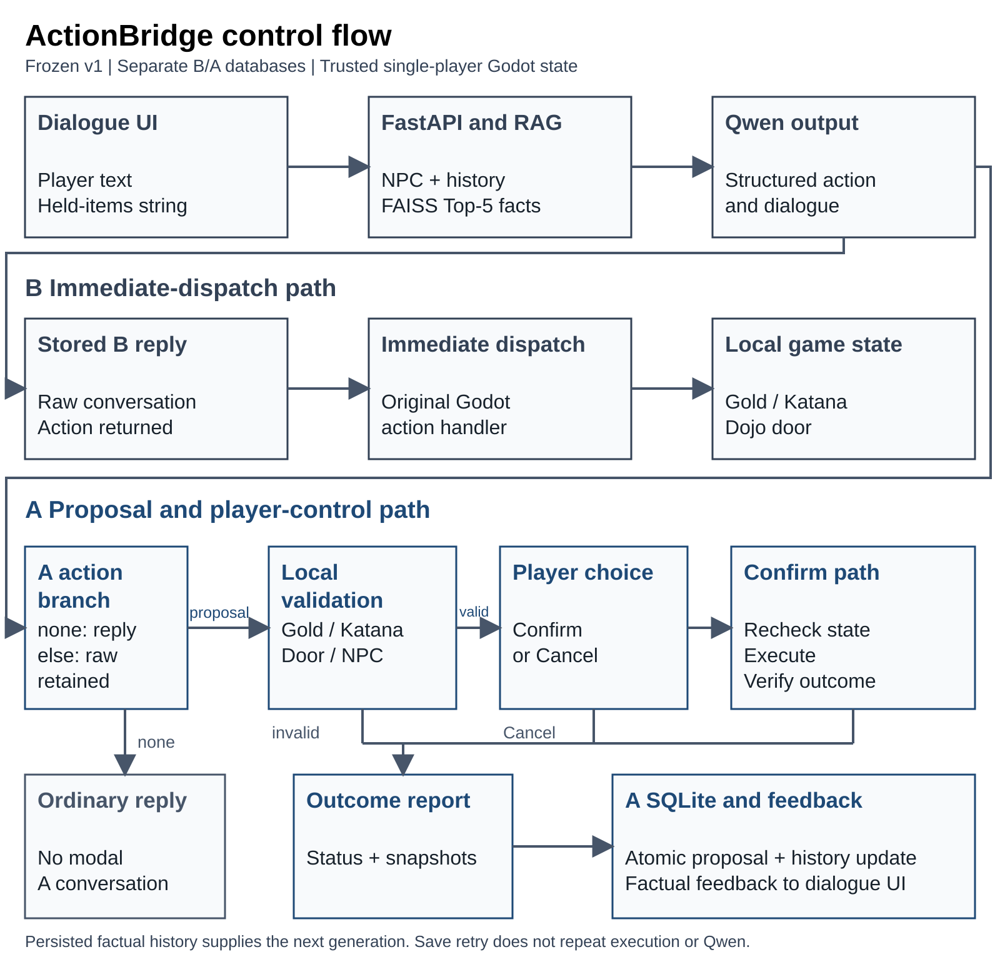

# NPC ActionBridge

README prose word count: 681 (headings included; commands, link targets and this line excluded).

NPC ActionBridge connects generated NPC dialogue to player-controlled game actions.
In an existing Godot RPG, it checks whether a proposed purchase or dojo opening
is possible, shows the consequence before Confirm/Cancel, and records what the
game actually did. The project studies how an NPC can offer consequential actions
without treating its own words as proof of execution.

## Research problem

A fluent NPC can say it has sold a sword or opened a door while the game state
says otherwise. A valid action may also be unwanted. ActionBridge addresses both
problems at the point where a dialogue proposal becomes an executable action.
The [report](report/REPORT_FINAL.md) explains the research question and design choices.

## Core interaction mechanism

1. Generate a structured NPC reply and action proposal.
2. Check the actual local Gold, Katana, door state and permitted NPC/action pairing.
3. Show the action and its cost through Confirm/Cancel.
4. On Confirm, recheck, execute and verify the resulting state. Cancel preserves state.
5. Reconcile the stored conversation with the outcome, retaining the raw proposal separately.

Ordinary `none` replies remain normal dialogue. Baseline B immediately dispatches
the returned action. ActionBridge A adds the validation, choice and outcome path.

## Architecture



Godot owns the trusted single-player inventory and door nodes. FastAPI assembles
NPC/history context, FAISS retrieves five world facts and Qwen generates a reply.
SQLite stores dialogue, proposals and reported outcomes. A persistence retry saves
the same result without repeating the action or generation.
[Architecture details](docs/ARCHITECTURE.md) show both B/A branches.

## Evaluation results

**46 offline tests passed.** Six paired execution scenarios used identical
supplied actions and controlled initial states:

| Scenario group | Baseline B | ActionBridge A |
|---|---|---|
| Three invalid actions | Executed all three | Rejected all three; state preserved |
| Two valid actions | Completed both | Completed both |
| One cancellation comparison | Dispatched the purchase | Retained 8 Gold and no Katana |

These are deterministic execution results, not a Qwen error-rate estimate.
Natural E3/E4 gameplay records illustrate progression and cancellation; the live
G1 pair returned `none` in both conditions. H-UI-01 is a separate preset-state,
guided student GUI replay. See [results and sources](evidence/SUMMARY.md) and
[interaction storyboards](docs/INTERACTIONS_TEXT.md).

## Repository structure

- `adapter/actionbridge/`: proposal API, Godot bridge and outcome persistence.
- `adapter/qwen_baseline/`: shared Qwen, retrieval and dialogue-history adapter.
- `adapter/tests/` and `phase2/evaluation/`: unit checks and paired fixtures.
- `tools/`: offline checks and assets-first runtime preparation.
- `report/`, `docs/`, `figures/` and `evidence/`: report text, design diagrams and results.
- `notices/`: upstream and third-party attribution.

## Reproduction and setup

Python 3.11 and separately acquired Godot 4.3 are the recorded versions. The
Windows assets-first headless procedure was verified with zero engine errors or
warnings. Linux and exported builds have not been verified.

Start in a fresh extraction of the release ZIP or GitHub source archive; the
exact-file check expects the archive's contents without Git metadata.

```powershell
$ReviewEnv = Join-Path $env:TEMP ('actionbridge-env-' + [guid]::NewGuid().ToString('N'))
py -3.11 -m venv $ReviewEnv
$ReviewPython = Join-Path $ReviewEnv 'Scripts/python.exe'
& $ReviewPython -m pip install -r requirements.txt
& $ReviewPython tools/verify_snapshot.py
& $ReviewPython -I tools/offline_unit_guard.py --repo . --result (Join-Path $ReviewEnv 'unit-results.json')
```

Use a new result path for each check. [Reproduction instructions](docs/REPRODUCTION.md)
cover the full paired replay. The game, seed database, engine and assets are
[acquired separately](docs/EXTERNAL_ASSETS.md); this repository contains the
integration code, not a complete game bundle. Offline checks need no Qwen key
or FAISS index. Live dialogue requires the reviewer's own credentials and a
trusted index; never commit keys or private runtime data.

## Contributions and AI assistance

The student chose the research scope and evaluation decisions, performed the
recorded gameplay and GUI replay, and reviewed results. Copilot, ChatGPT and Codex
assisted implementation, debugging, evidence analysis, diagrams and writing.
Suggestions were revised to distinguish execution results from model accuracy,
and checked against actual Godot state, SQLite, source hashes and rendered reports.
[Development and assistance](docs/CONTRIBUTIONS_AI.md) identifies the main changes
and the reused game/framework.

## Licence and acknowledgements

The game and dialogue framework come from
[generative-npc-dialogue](https://github.com/V-o-id/generative-npc-dialogue), pinned
to `1dc1ab3624b1475d1975e8e1e6dd86f0c171f265`. Its MIT notice is retained.
MIT covers the 36 identified original code/configuration files and original
additions in five mixed files. The [file-level scope](docs/LICENCE_SCOPE.md)
and [licence](LICENSE) define this grant; upstream and other third-party
terms remain in force. Reports, diagrams, data and private records are
outside the original-code grant.
Game screenshots, artwork, fonts and audio are excluded from this code snapshot;
see [third-party notices](THIRD_PARTY_NOTICES.md) for the external materials.
