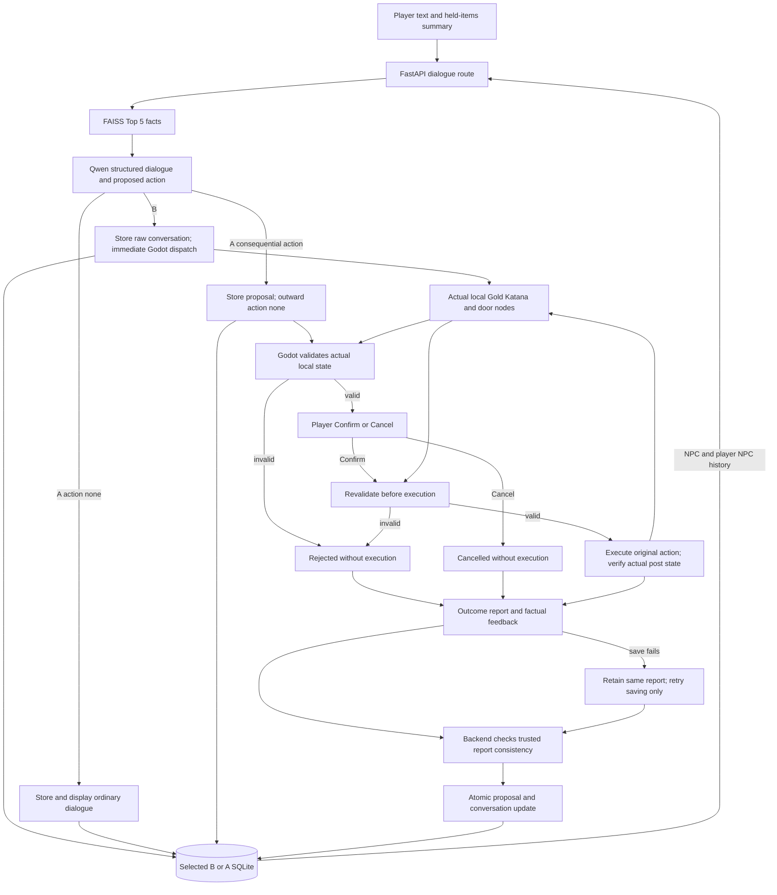

# ActionBridge architecture

Frozen v1 is `a613062`. Baseline B and enhanced A are alternative conditions with
separate SQLite databases; shared inference does not merge their histories.
The diagram is an implementation description, not an experiment or screenshot.

Only `Committed` preserves the consequential action in the linked conversation;
`Rejected`, `Cancelled` and `Failed` do not. Backend checks can downgrade an
inconsistent committed report, but do not independently observe inventory.
Save retry blocks new generation and does not execute the action again or call
the model. In an indoor shop, the dojo node may be absent and door state null.
Confirming a state-valid proposal does not prove correct intent interpretation.

Source: [baseline context/storage](../adapter/qwen_baseline/fastapi_app.py),
[proposal wrapper](../adapter/actionbridge/api.py),
[Godot boundary](../adapter/actionbridge/godot/ActionBridge.gd),
[save-only retry](../adapter/actionbridge/godot/ActionBridgeUI.gd), and
[outcome store](../adapter/actionbridge/store.py).
