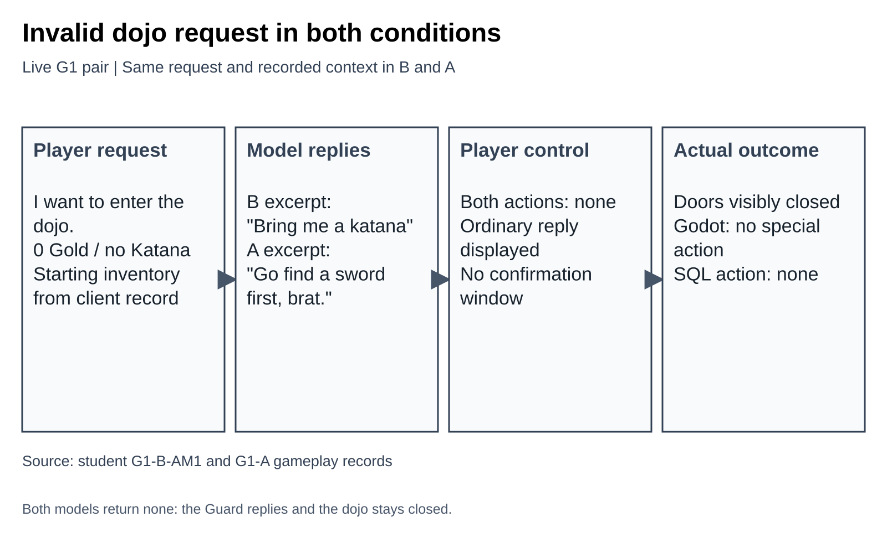
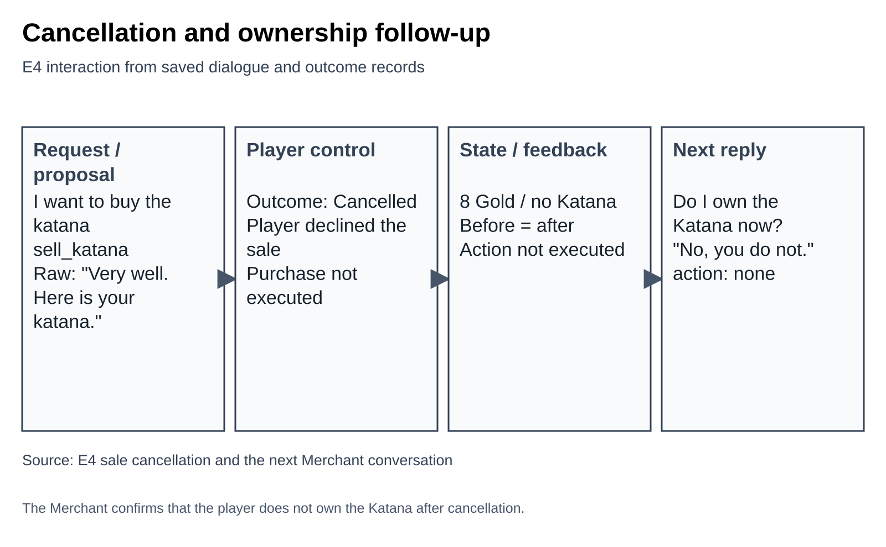
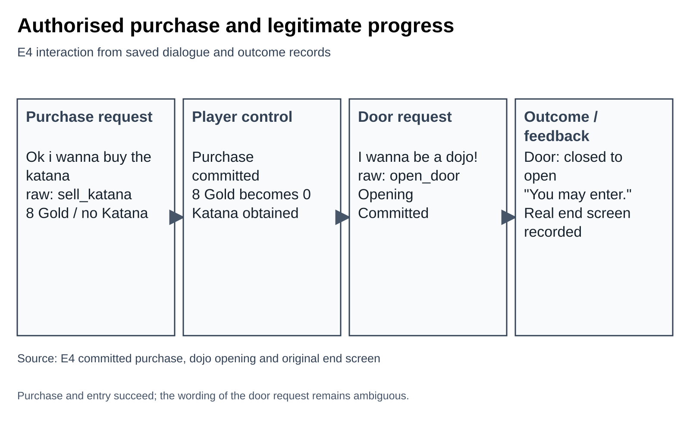

# Interaction storyboards

These diagrams summarise saved dialogue and outcome records. Original game
captures appear in the separate illustrated coursework report.

## G1 request without a Katana

The student submitted the same request in B and A with no Katana. Both models
returned `none`, and the doors stayed closed. Recorded retrieval/generation
contexts matched. This sequence follows ordinary dialogue without a modal.

## E4 cancellation and ownership follow-up

The raw sale proposal is retained separately from the cancelled outcome.
Cancellation kept eight Gold and no Katana; the next generated ownership reply
correctly said the player did not own the sword. The diagram is drawn from E4
records, rather than recreating a historical confirmation-window screenshot.

## E4 purchase and dojo entry

A later purchase was committed, followed by a committed dojo opening. The actual
input `I wanna be a dojo!` is retained because it shows the distinction between a
legal state transition and an unambiguous request.

## H-UI-01 purchase controls

The separate H-UI-01 guided GUI replay starts with preset eight Gold and supplied
purchase proposals. The student chose Cancel, then Confirm. The three original
images show the proposal, eight Gold retained after cancellation, and zero Gold
plus Katana after confirmation. No model generation or API/SQLite saving occurs
in this fixture. These images are H evidence, separate from E4 natural gameplay.

## H-UI-02 shop dialogue presentation

The final report's Figure 5 uses a separate preset-state replay in the shop
layout. Fixed Merchant lines replace the mechanical state wording in the
speech box. The actual Confirm/Cancel controls, state checks and action code
are unchanged. The student cancels the first proposal, then confirms a second.
Figure 5b shows that second proposal alongside the cancellation response and
unchanged eight-Gold inventory. The last frame shows a Katana and no Gold.
These are supplied proposals and authored display lines, with no Qwen request,
HTTP coordination or SQLite save. The development rationale and checked
execution path are in the [development record](CONTRIBUTIONS_AI.md#h-ui-02-presentation-decision-and-check).
