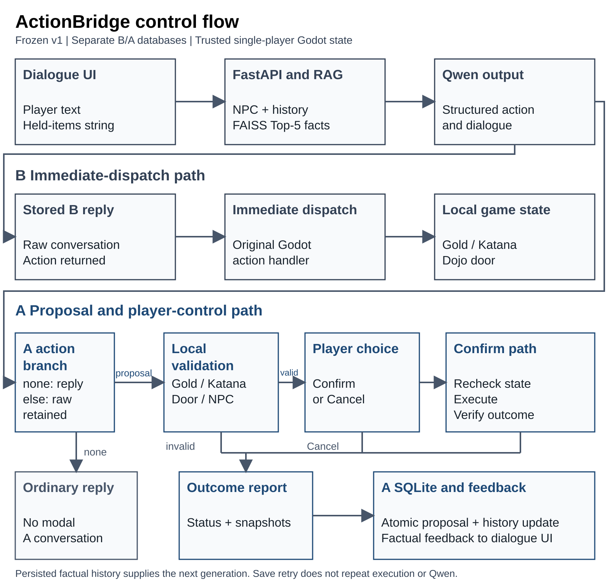

# NPC ActionBridge for Grounded Game Actions and Player Control

IIS A2

Main report including title, headings and Table 1: 1003 words. Abstract including heading: 191 words. Combined: 1194 words.

## Abstract

Generated dialogue can announce a purchase or an opened door before a game has established either outcome. NPC ActionBridge connects non-player character (NPC) proposals generated by a large language model (LLM) to game-state validation, player confirmation and factual outcome feedback in an existing Godot game. Baseline B dispatches generated actions immediately; ActionBridge A checks prerequisites, offers Confirm/Cancel, rechecks before execution and updates dialogue history from the reported result. Ordinary dialogue needs no confirmation. Six deterministic paired scenarios supplied identical actions to both systems. Baseline executed all three invalid actions, while ActionBridge rejected them. Both completed the two valid actions. In the cancellation comparison, ActionBridge retained eight Gold and no Katana, while Baseline dispatched the purchase. Linked conversations retained committed actions and recorded none for rejected or cancelled proposals. Original gameplay records show cancellation, a consistent ownership follow-up and successful progression; a matched live Guard pair returned none in both conditions. A student-operated, preset-state GUI replay makes the purchase controls and inventory changes visible. Together, the model-generated dialogue and controlled execution tests demonstrate a mechanism that preserves legitimate progression while allowing players to decide when a proposed action changes the game.

## Problem and Scope

A fluent reply can describe giving a sword without changing inventory. This project asks: How can consequential actions proposed during LLM-driven NPC dialogue be grounded in game state, authorised by players and reconciled with actual execution? A1 proposed comparing refusal strategies for requests conflicting with quest state. A2 instead investigates execution when buying a Katana or opening the dojo. Reusing an independent third-party game provided an inspectable baseline. Keeping its original immediate-dispatch path as the comparator held the game mechanics fixed, so differences in the supplied-action tests could be traced to execution safeguards.

## Design Rationale

Understanding a request, satisfying game rules and obtaining permission are different requirements. Prompts can describe the eight-Gold price or the need for a Katana; executable code checks whether those requirements are met. Rao et al. (2024, section 2.2) return function results to NPC dialogue, and Phillips et al. (2025) describe structured states for goal progression. These approaches informed the decision to connect dialogue to explicit state transitions.

An affordable purchase still needs the player's permission. Week 2's lab worksheet asks whether people can correct an inference and see its consequences (sections 2 and 5); Week 4 requires visible arguments before confirmation (step 7). The window therefore names the Katana and its eight-Gold cost. A player can decline an affordable sale, making cancellation a normal outcome. Only valid consequential proposals open the confirmation window. Revalidation after Confirm checks that the same transaction remains possible before committing it.

Week 4's instruction to report returned results (step 8) shaped the feedback after a choice. A cancelled purchase should leave the player knowing that the Gold is still available. ActionBridge derives this message from the outcome report and updates the linked conversation, giving later dialogue access to the result. Retaining the raw proposal separately preserves the distinction between what was proposed and what happened.

## System and Implementation

Both versions use the Qwen-adapted upstream dialogue backend. Godot sends player text and held items to FastAPI. Retrieval-augmented generation (RAG) combines NPC instructions, target-NPC history and five FAISS world facts before Qwen (qwen3.7-flash) generates a structured reply and action. In Baseline B, the backend stores the response; Godot dispatches the returned action through its original handler.

In A, a consequential reply creates a separately stored proposal and returns pending feedback with none as the immediate action. Godot checks the NPC/action pairing, Gold, Katana and door before presenting confirmation. Confirm triggers revalidation, execution and a check of the resulting state; Cancel leaves the action unexecuted. An outcome report atomically updates the SQLite proposal and linked conversation, so later dialogue reads factual outcome feedback (Figure 1). Ordinary none replies bypass confirmation.

Godot remains the trusted single-player state authority; the backend validates reported transitions. A save retry resends the same outcome without repeating the action or model generation. Outcome feedback uses recorded state and requires no additional model call.

## Illustrated Interaction and Evaluation

Six deterministic pairs sent identical supplied actions through FastAPI, actual headless Godot functions and SQLite (Table 1). B executed three invalid proposals: purchases with seven and zero Gold, and opening without a Katana. A rejected all three, preserving their initial states. Keeping the seven Gold leaves the player one coin short of the price, preserving progress towards a legitimate purchase. Both systems completed the valid eight-Gold purchase and opened the dojo while carrying a Katana. In the cancellation comparison, A's programmed Cancel kept eight Gold and no Katana; B immediately dispatched the purchase.

Across the six pairs, SQLite stored rejected and cancelled proposals with none in their linked conversations; committed purchases and openings retained sell_katana and open_door.

The original gameplay sessions, E3 (Baseline B) and E4 (ActionBridge A), show purchase and admission in B, and cancellation and progression in A (Figures 3–4). E4's ownership reply after cancellation agreed with the unchanged inventory. Their utterances and histories differ, so these are not matched comparisons. The matched live G1 pair used the same no-Katana request, empty target history and identical recorded retrieval results and generation contexts. Qwen returned none in both conditions, leaving the doors closed (Figure 2).

H-UI-01 recorded Cancel retaining eight Gold and no Katana, then Confirm producing zero Gold and a Katana. H-UI-02 shows these controls in the shop, with fixed Merchant lines selected from outcomes (Figure 5). Both are student-operated, preset-state GUI replays with locally supplied proposals, without calling the model or saving outcomes to the database. The deterministic scenarios establish execution safeguards under supplied actions; live model error rates and perceived usability were not measured.

## Development and Reflection

I selected the scope and evaluation, performed the gameplay and GUI replays, and reviewed outcomes. I also requested natural Merchant dialogue after rejecting mechanical state messages. Copilot, ChatGPT and Codex assisted coding, debugging, evidence organisation, diagrams and writing. Initial Godot imports failed; preparing raw assets before restoring scenes and autoloads produced working Windows runtimes. The final candidate passed 46 offline Python checks and six paired Godot integration scenarios; the engine runs recorded zero errors or warnings.

Confirmation makes the consequence visible but adds a pause to play. Restricting it to actions that change inventory or access keeps that cost attached to a meaningful decision. The two valid-action scenarios show that the intervention also preserves legitimate progression. Blocking every proposed action would prevent that progress, so rejection alone would be an inadequate safeguard. Confirmation still leaves a separate problem: E4's "I wanna be a dojo!" produced a legal opening proposal despite an ambiguous request. Approving the displayed action does not establish that the model understood the intended goal. The player can authorise a concrete action even when the original request needs clarification.

Table 1. Six deterministic supplied-action pairs: three invalid, two valid and one cancellation. State is Gold/Katana/door. A's Confirm/Cancel choices were programmed.

| Scenario | Initial state | Supplied action | B after | A after | A outcome |
|---|---|---|---|---|---|
| Invalid purchase: 7 Gold | 7/no/closed | sell_katana | 0/yes/closed | 7/no/closed | Rejected |
| Invalid purchase: 0 Gold | 0/no/closed | sell_katana | 0/yes/closed | 0/no/closed | Rejected |
| Invalid opening: no Katana | 0/no/closed | open_door | 0/no/open | 0/no/closed | Rejected |
| Valid purchase | 8/no/closed | sell_katana | 0/yes/closed | 0/yes/closed | Committed |
| Valid opening | 0/yes/closed | open_door | 0/yes/open | 0/yes/open | Committed |
| Cancel purchase in A | 8/no/closed | sell_katana | 0/yes/closed | 8/no/closed | Cancelled |

## Architecture and illustrated interactions

The [interaction records](../docs/INTERACTIONS_TEXT.md) describe the three G1/E4 storyboards and the H-UI-02 sequence. The separately submitted illustrated report includes the original game captures. Figure 5b shows the second purchase proposal after cancellation, with eight Gold and no Katana retained.

## References

Rao, S., Xu, W., Xu, M., Leandro, J., Lobb, K., DesGarennes, G., Brockett, C., & Dolan, B. (2024). Collaborative quest completion with LLM-driven non-player characters in Minecraft. arXiv. https://doi.org/10.48550/arXiv.2407.03460

Phillips, A., Lang, J., & Mould, D. (2025). Goal-oriented interactions in games using LLMs. IEEE Transactions on Games, 17(2), 510–521. https://doi.org/10.1109/TG.2024.3515807

Lab 2 worksheet [Week 2 course worksheet, sections 2 and 5]. (n.d.).

Lab 4—Student To-Do: LLM/VLM integration, retrieval and tool use [Week 4 course lab guide, steps 6–8]. (n.d.).

V-o-id. (n.d.). generative-npc-dialogue [Source code, frozen commit 1dc1ab3624b1475d1975e8e1e6dd86f0c171f265]. https://github.com/V-o-id/generative-npc-dialogue

## Repository and development record

[Public repository](https://github.com/wawayuzhuzhou/npc-actionbridge-iis-a2)

[README and Contributions and AI assistance](../README.md#contributions-and-ai-assistance)

[Development record](../docs/CONTRIBUTIONS_AI.md)
